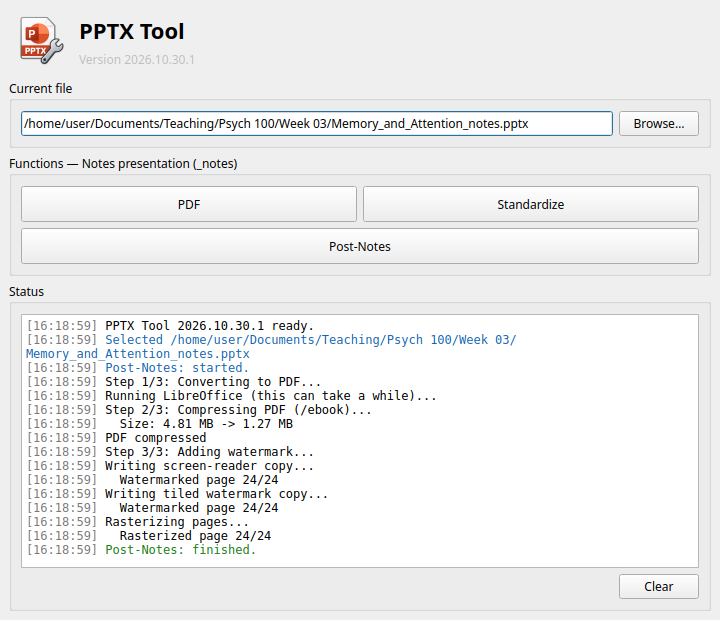

# PPTX Tool

[](https://www.gnu.org/licenses/lgpl-3.0)[](https://github.com/owner/repo/actions)[](https://github.com/owner/repo/actions)[](https://github.com/owner/repo/actions)

Travis L. Seymour, PhD. 2006

A GUI application for turning PowerPoint decks into printer-friendly notes and watermarked, compressed PDF handouts.

> NOTE: Functions that produce PDFs produce a normal one `[ORIG FILENAME].pdf`, and a reader one `[ORIG FILENAME]_reader.pdf`. The `_reader.pdf` one is probably the one you want: it's small and compact, and compatible with screen readers. The <i>regular</i> one is odd in that it creates an image based pdf that is much larger, but gives tools trying to remove the watermark more trouble. Use whichever one you want, for my purposes, the odd one is kept as the default. For those needed a screen-reader compatible version, I will give them the `_reader.pdf` version.

[](pptxtool/resources/pptxtool_ui.png)

---

## Features

Choose a file with **Browse…** or drag it onto the window. The available functions depend on the file:

| File              | Functions                                               |
| ----------------- | ------------------------------------------------------- |
| `deck.pptx`       | PDF, PDF + Watermark + Compress, Pre-Notes, Standardize |
| `deck_notes.pptx` | PDF, Post-Notes, Standardize                            |
| `file.pdf`        | Compress, Watermark                                     |

- **PDF**: convert to PDF with LibreOffice.
- **Pre-Notes**: write a printer-friendly `<stem>_notes.pptx` (black Arial text, black round bullets, white backgrounds, no master decorations or hidden slides).
- **Post-Notes** / **PDF + Watermark + Compress**: PDF, compress, then write a watermarked `<stem>_reader.pdf` (selectable text) and a raster `<stem>.pdf`.
- **Standardize**: Arial fonts and black round bullets, edited in place.
- **Compress**: shrink a PDF with Ghostscript.
- **Watermark**: write reader and raster watermarked copies of a PDF.

Settings you change in a dialog (watermark text, opacity, angle, PDF quality, and so on) are remembered for next time once you press **Start**. **Restore Defaults** puts a dialog's settings back. The watermark text defaults to the author's copyright line; the **Default** button beside it restores just that text.

Each function opens a dialog that describes what will happen, shows its settings and output files, and asks before overwriting anything. Progress appears in the Status area. The app follows the system light/dark setting.

You can also pass a file on the command line: `pptxtool deck.pptx`.

## System Dependencies

- [LibreOffice](https://www.libreoffice.org/) (`libreoffice` or `soffice` on PATH) for PDF conversion
- [Ghostscript](https://ghostscript.com/) (`gs` on PATH) for compression

On Debian/Ubuntu: `sudo apt install libreoffice-impress ghostscript`

## Installation

#### Install uv

- Installing uv on linux and macos

```bash
curl -LsSf https://astral.sh/uv/install.sh | sh
```

- Installing uv on Windows

```bash
powershell -ExecutionPolicy ByPass -c "irm https://astral.sh/uv/install.ps1 | iex"
```

#### Install PPTX Tool

```bash
uv tool install git+https://github.com/travisseymour/pptxtool
# or, from a local checkout:
uv tool install .
```

### Update PPTX Tool

```bash
uv tool upgrade pptxtool
```

### Uninstall PPTX Tool

```bash
uv tool uninstall pptxtool
```

## License

GPLv3+
